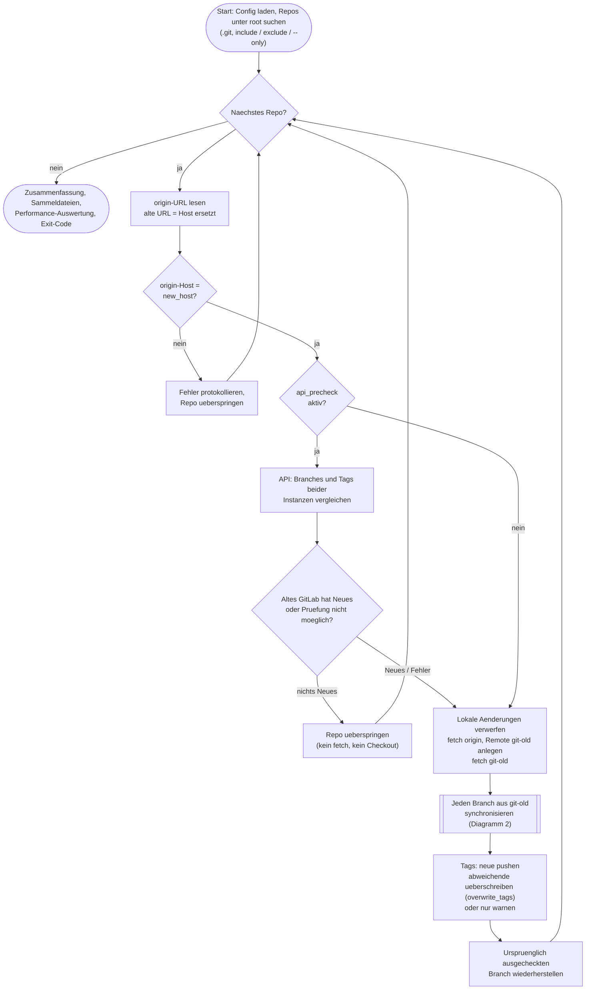
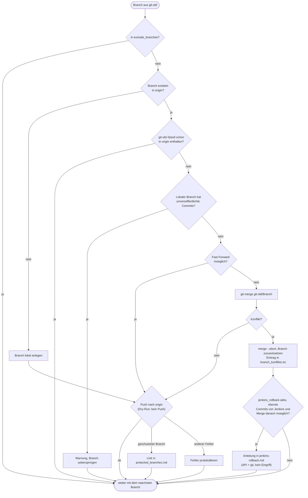

# Ablauf von gitlab-sync

Die Diagramme sind Mermaid (werden in GitLab/GitHub und den meisten Markdown-Vorschauen direkt gerendert).
Als Bild: [Gesamtablauf](ablauf-gesamt.png) und [Ablauf pro Branch](ablauf-branch.png).

## 1. Gesamtablauf (pro Lauf und pro Repo)

## 2. Ablauf pro Branch

