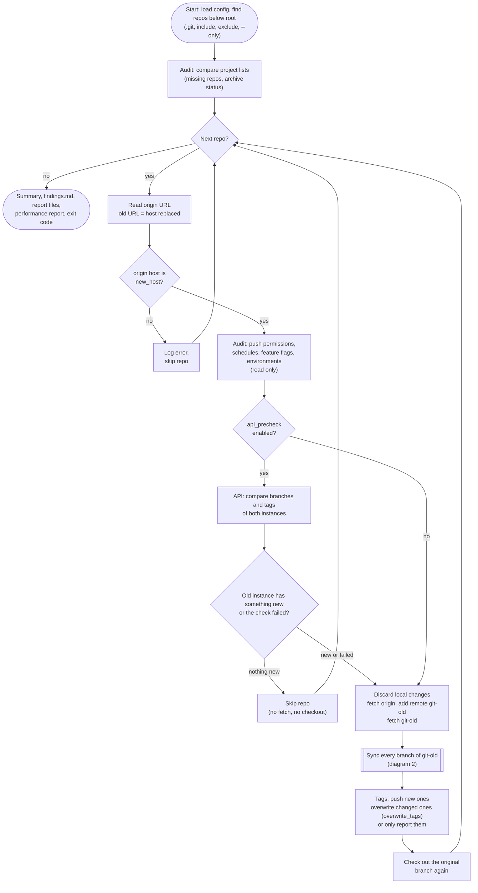
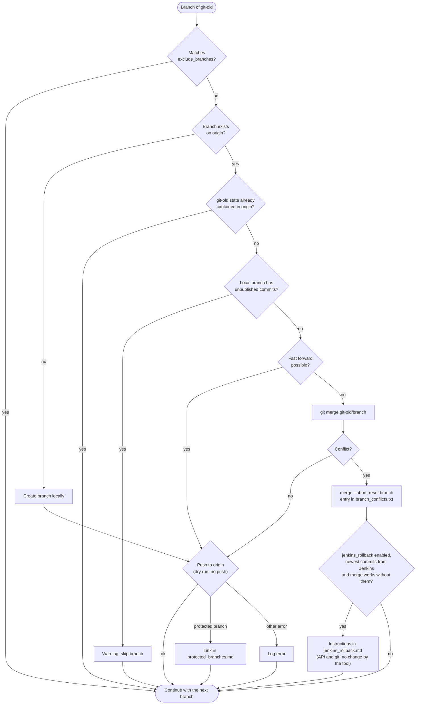

# gitlab_sync flow

The diagrams are Mermaid and render directly in GitLab, GitHub and most Markdown previews.
Rendered images: [overall flow](flow_overall.png) and [flow per branch](flow_branch.png).

## 1. Overall flow per run and per repo

## 2. Flow per branch

